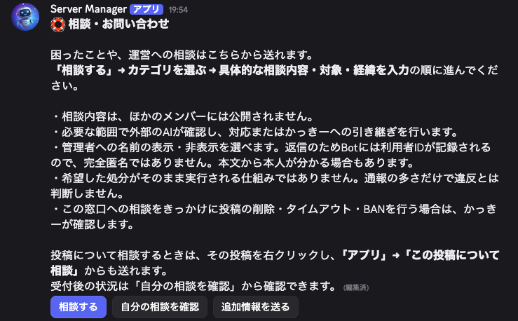
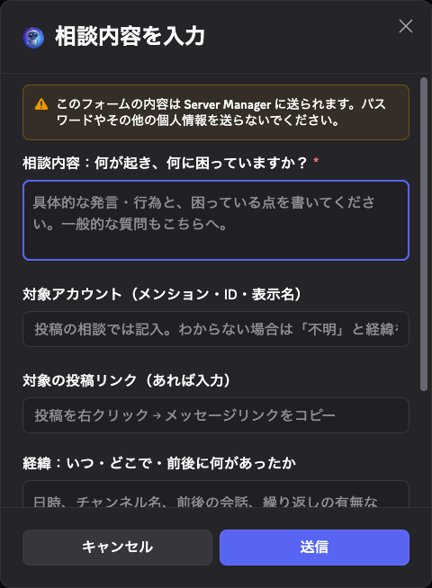

# 相談受付と管理者確認の動作例

2026年11月3日の本番画面です。一般メンバーの相談本文やアカウント情報は含めていません。

## 相談入口

利用者が操作したときだけ相談フォームを開きます。外部AIを必要な範囲で利用すること、一般メンバーには非公開であること、名前非表示の限界を案内しています。

## 具体的な相談内容の入力

カテゴリを選び、対象アカウント、投稿リンク、具体的な内容、日時・場所・経緯、希望する対応を入力します。右クリックの相談では対象投稿が指定されます。

## 確認の流れ

Botは、相談者とBotの双方が閲覧できる対象だけを扱います。一次判定はTypeSafeのJev APIです。申告と取得できた投稿を区別し、取得できなかった本文を推測で補いません。情報不足や運営判断が必要な案件は、非公開の運営ログへ送ります。

管理者が削除を行う場合は、対象投稿のリンクを直接確認し、理由を選択して承認します。現在のサーバー所有者本人だけがこの操作を行えます。Botは実行前に対象ID、投稿者、編集情報、権限、承認期限を再確認します。メンバーからの通報件数や処分希望によって、自動で削除・BANする仕組みではありません。

## Message Content Intentが必要な部分

右クリックで渡される1投稿だけでは、引用、冗談、前後の応答、すでに終わった話題などを十分に区別できません。利用者が指定した投稿と、同じチャンネルの直前・直後各10件、必要な返信先を確認に使うため、本文取得の権限を申請します。承認前に前後の本文を取得できたかのような説明はしていません。

## 検証の範囲

110件の自動テストで、入力・本人確認・閲覧範囲・改変検知・重複防止・失敗時の保留などを確認しました。本番でも専用のテスト投稿を作り、管理者の確認画面を通して1投稿だけ削除できることを確認しています。通常のメンバーの投稿を検証のために削除したものではありません。これらはモデルがあらゆる事例で正しく判断することの保証ではありません。
